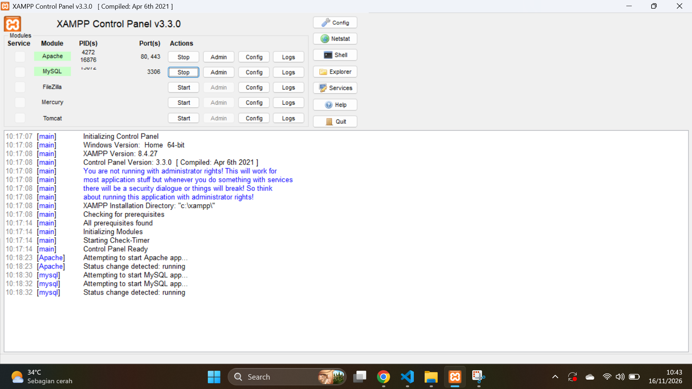
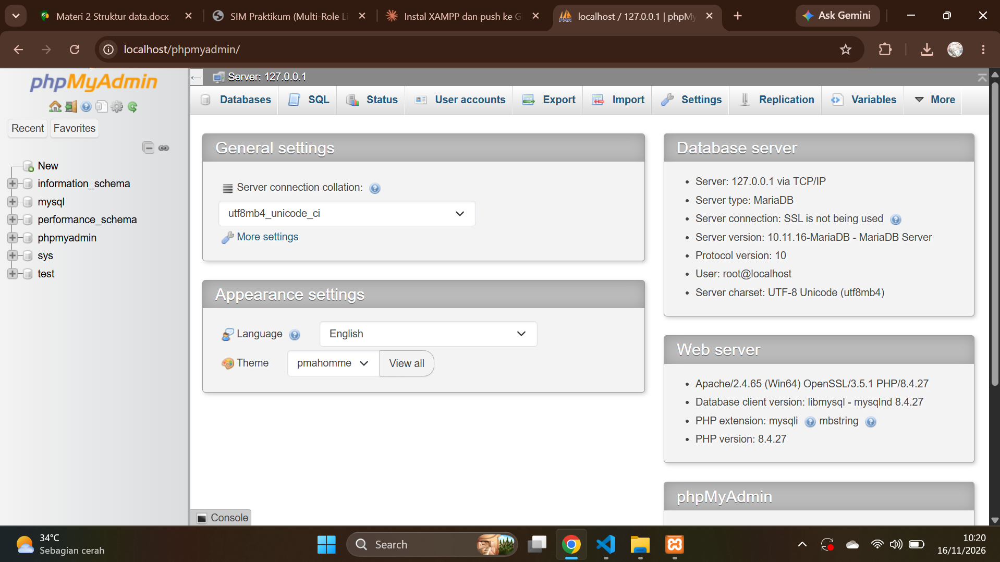
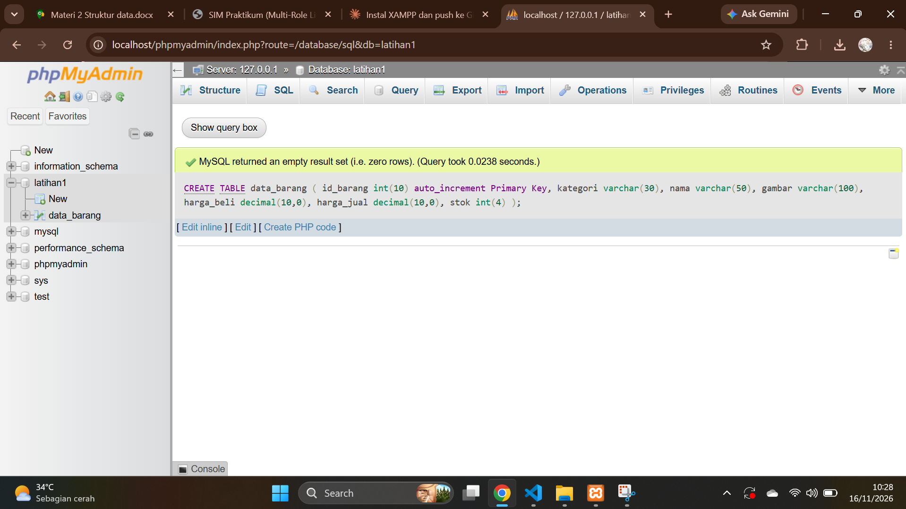
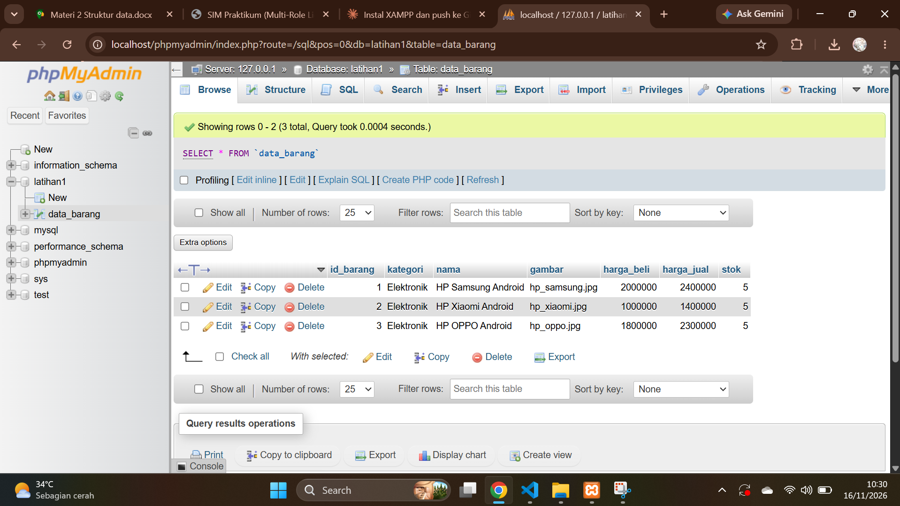
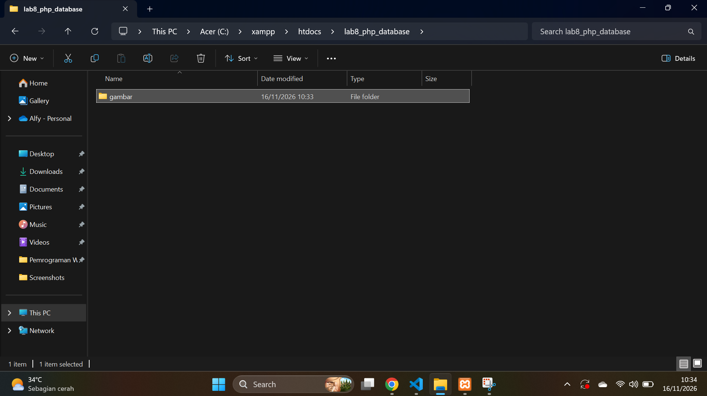
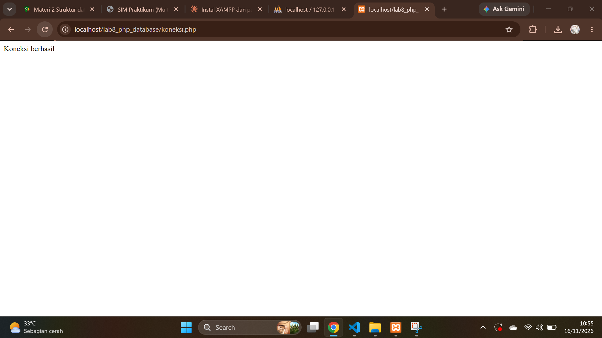
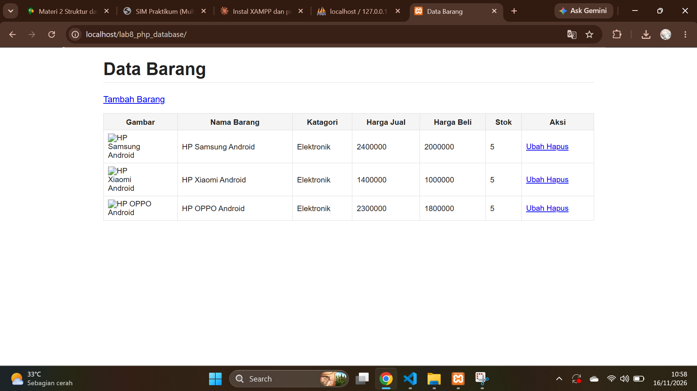
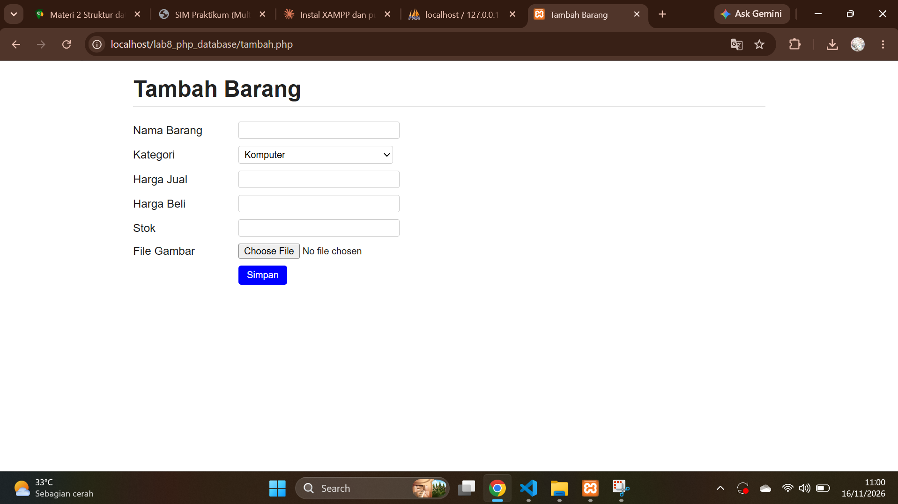
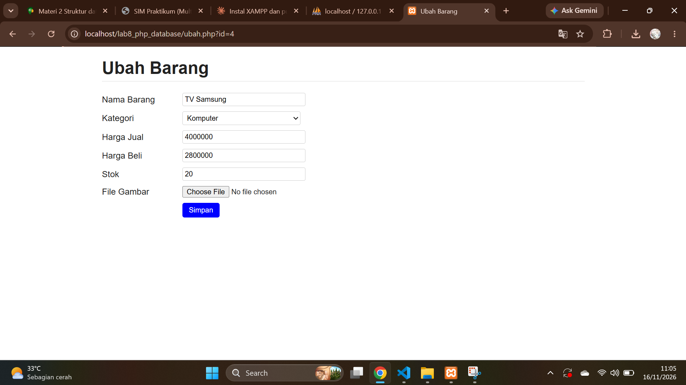
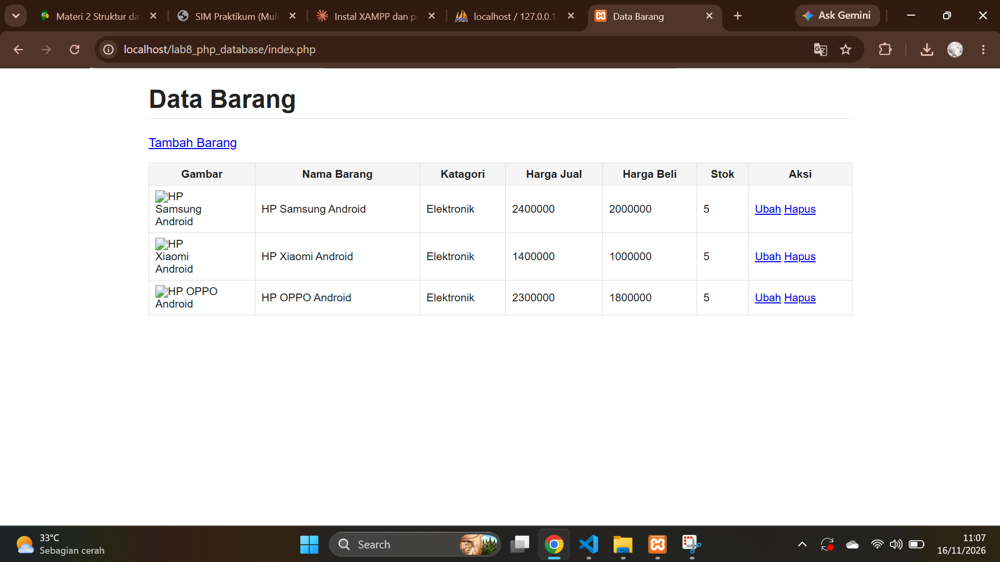

# Praktikum 8: PHP dan Database MySQL

- **Nama:** Alfy Ramadhan
- **NIM:** 312510298
- **Program Studi:** Teknik Informatika
- **Mata Kuliah:** Pemrograman Web

## Tujuan
1. Memahami konsep dasar database.
2. Memahami konsep dasar CRUD menggunakan PHP.
3. Membuat program CRUD sederhana menggunakan PHP.

## Lingkungan Praktikum

| Komponen | Versi / Keterangan |
|---|---|
| XAMPP | 8.4.27 (Windows 64-bit), folder instalasi `C:\xampp` |
| Web server | Apache 2.4.65 |
| PHP | 8.4.27 |
| Database | MariaDB bawaan XAMPP, diakses lewat phpMyAdmin |
| Text editor | Visual Studio Code |

## Struktur Proyek

```
lab8_php_database/
├── gambar/          (gambar barang: hp_samsung.jpg, hp_xiaomi.jpg, hp_oppo.jpg, dan hasil upload)
├── screenshots/     (bukti hasil praktikum)
├── koneksi.php      (koneksi ke database)
├── index.php        (Read: menampilkan data)
├── tambah.php       (Create: menambah data)
├── ubah.php         (Update: mengubah data)
├── hapus.php        (Delete: menghapus data)
├── style.css        (tampilan)
└── README.md
```

---

## 1. Persiapan: Menjalankan MySQL Server

Aplikasi CRUD membutuhkan database server. Server dijalankan lewat **XAMPP Control Panel** dengan menekan tombol **Start** pada modul **Apache** (web server yang menjalankan PHP) dan **MySQL** (database server).



**Hasil:** Modul Apache dan MySQL berwarna hijau. Apache berjalan di port 80 dan 443, MySQL berjalan di port 3306. Log di bagian bawah menampilkan `Status change detected: running` untuk keduanya, tanpa pesan error.

## 2. Mengakses MySQL Client dengan phpMyAdmin

phpMyAdmin adalah aplikasi berbasis web untuk mengelola database. Aksesnya melalui browser di alamat `http://localhost/phpmyadmin/` (Apache dan MySQL harus sudah berjalan).



**Hasil:** Halaman utama phpMyAdmin terbuka dan terhubung ke server `127.0.0.1`. Panel kiri menampilkan database bawaan: `information_schema`, `mysql`, `performance_schema`, `phpmyadmin`, `sys`, dan `test`. Database `latihan1` belum ada pada tahap ini.

## 3. Membuat Database dan Tabel

Studi kasus: **Data Barang**.

**Rancangan tabel `data_barang`:**

| Nama Field | Tipe Data | Ukuran | Keterangan |
|---|---|---|---|
| id_barang | INT | 10 | Primary Key, Auto Increment |
| kategori | VARCHAR | 30 | |
| nama | VARCHAR | 50 | |
| gambar | VARCHAR | 100 | Nama file gambar |
| harga_beli | DECIMAL | 10,0 | |
| harga_jual | DECIMAL | 10,0 | |
| stok | INT | 4 | |

**Membuat database.** Perintah dijalankan di tab **SQL** phpMyAdmin:

```sql
CREATE DATABASE latihan1;
```

**Membuat tabel.** Database `latihan1` dipilih terlebih dahulu di panel kiri, kemudian perintah berikut dijalankan:

```sql
CREATE TABLE data_barang (
  id_barang int(10) auto_increment Primary Key,
  kategori varchar(30),
  nama varchar(50),
  gambar varchar(100),
  harga_beli decimal(10,0),
  harga_jual decimal(10,0),
  stok int(4)
);
```



**Hasil:** Muncul pesan hijau `MySQL returned an empty result set (i.e. zero rows)`, yang menandakan perintah berhasil dijalankan. Database `latihan1` tampil di panel kiri dan di dalamnya terdapat tabel `data_barang`.

> Catatan: pada saat membuat database, phpMyAdmin sempat menampilkan error `#1046 No database selected`. Error ini berasal dari query tambahan phpMyAdmin saat belum ada database yang dipilih, bukan dari perintah `CREATE DATABASE`. Database tetap berhasil dibuat.

## 4. Menambahkan Data

Tiga data awal dimasukkan dengan perintah `INSERT`:

```sql
INSERT INTO data_barang (kategori, nama, gambar, harga_beli, harga_jual, stok)
VALUES ('Elektronik', 'HP Samsung Android', 'hp_samsung.jpg', 2000000, 2400000, 5),
('Elektronik', 'HP Xiaomi Android', 'hp_xiaomi.jpg', 1000000, 1400000, 5),
('Elektronik', 'HP OPPO Android', 'hp_oppo.jpg', 1800000, 2300000, 5);
```



**Hasil:** Tab Browse tabel `data_barang` menampilkan `Showing rows 0 - 2 (3 total)`. Isi tabel:

| id_barang | kategori | nama | gambar | harga_beli | harga_jual | stok |
|---|---|---|---|---|---|---|
| 1 | Elektronik | HP Samsung Android | hp_samsung.jpg | 2000000 | 2400000 | 5 |
| 2 | Elektronik | HP Xiaomi Android | hp_xiaomi.jpg | 1000000 | 1400000 | 5 |
| 3 | Elektronik | HP OPPO Android | hp_oppo.jpg | 1800000 | 2300000 | 5 |

Kolom `id_barang` terisi otomatis (1, 2, 3) karena memakai `auto_increment`.

## 5. Membuat Program CRUD

Folder proyek `lab8_php_database` dibuat di `C:\xampp\htdocs` (document root Apache), sehingga dapat diakses di `http://localhost/lab8_php_database/`.



**Hasil:** Folder `lab8_php_database` berada di dalam `htdocs`, berisi file PHP program dan folder `gambar` untuk menyimpan gambar barang.

### 5.1 File koneksi (`koneksi.php`)

File ini menyimpan konfigurasi koneksi (host, user, password, nama database) dan membuka koneksi dengan `mysqli_connect()`. File di-`include` oleh file lain agar konfigurasi cukup ditulis satu kali. Jika koneksi gagal, program berhenti dan menampilkan pesan error.

```php
$conn = mysqli_connect($host, $user, $pass, $db);
if ($conn == false)
{
    echo "Koneksi ke server gagal.";
    die();
}
```

Untuk pengujian, baris `#else echo "Koneksi berhasil";` di-uncomment sementara, lalu dikembalikan seperti semula setelah pengujian selesai.



**Hasil:** Browser menampilkan tulisan **Koneksi berhasil** pada alamat `localhost/lab8_php_database/koneksi.php`, yang menandakan PHP berhasil terhubung ke database `latihan1`.

### 5.2 Menampilkan data / Read (`index.php`)

File ini menjalankan `SELECT * FROM data_barang`, lalu menampilkan setiap baris hasilnya ke dalam tabel HTML dengan perulangan `while` dan `mysqli_fetch_array()`. Kolom **Aksi** berisi tautan **Ubah** dan **Hapus**, dan di atas tabel terdapat tautan **Tambah Barang**. Jika tabel kosong, ditampilkan tulisan "Belum ada data".

```php
$sql = 'SELECT * FROM data_barang';
$result = mysqli_query($conn, $sql);
while($row = mysqli_fetch_array($result)) { ... }
```



**Hasil:** Halaman **Data Barang** menampilkan tabel dengan kolom Gambar, Nama Barang, Kategori, Harga Jual, Harga Beli, Stok, dan Aksi. Tiga barang awal (HP Samsung Android, HP Xiaomi Android, HP OPPO Android) tampil lengkap dengan gambarnya, dan masing-masing memiliki tautan Ubah dan Hapus.

### 5.3 Menambah data / Create (`tambah.php`)

File ini berisi form (`method="post"` dan `enctype="multipart/form-data"` agar bisa mengunggah file) dengan isian nama, kategori, harga jual, harga beli, stok, dan file gambar. Saat tombol **Simpan** ditekan:
1. Data dari `$_POST` dan file dari `$_FILES` diterima.
2. Gambar dipindahkan ke folder `gambar/` dengan `move_uploaded_file()`.
3. Data disimpan ke tabel dengan perintah `INSERT`.
4. Halaman diarahkan kembali ke `index.php`.

```php
$sql = 'INSERT INTO data_barang (nama, kategori, harga_jual, harga_beli, stok, gambar) VALUES (?, ?, ?, ?, ?, ?)';
```



**Hasil:** Halaman **Tambah Barang** menampilkan form dengan kolom Nama Barang, Kategori (pilihan Komputer, Elektronik, Hand Phone), Harga Jual, Harga Beli, Stok, File Gambar, dan tombol **Simpan**.

**Pengujian:** Data baru `TV Samsung` (kategori Elektronik, harga jual 4000000, harga beli 2800000, stok 20) disimpan beserta gambarnya. Setelah **Simpan**, halaman kembali ke index dan barang tersebut muncul sebagai baris keempat, dengan gambar tersimpan di folder `gambar/`.

### 5.4 Mengubah data / Update (`ubah.php`)

File ini menerima `id` barang lewat URL (`ubah.php?id=...`), mengambil datanya dengan `SELECT ... WHERE id_barang`, dan menampilkannya di dalam form agar bisa diedit. Saat disimpan, data diperbarui dengan `UPDATE ... WHERE id_barang`. Gambar hanya diganti jika pengguna memilih file baru; jika dikosongkan, gambar lama tetap dipakai.

```php
$sql = 'UPDATE data_barang SET nama = ?, kategori = ?, harga_jual = ?, harga_beli = ?, stok = ? WHERE id_barang = ?';
```



**Hasil:** Halaman **Ubah Barang** terbuka dengan form yang sudah terisi data lama barang yang dipilih (nama, harga jual, harga beli, stok), dan pilihan Kategori otomatis terpilih sesuai data.

**Pengujian:** Stok `TV Samsung` diubah dari `20` menjadi `15`. Setelah **Simpan**, halaman kembali ke index dan nilai stok pada baris tersebut berubah menjadi `15`.

### 5.5 Menghapus data / Delete (`hapus.php`)

File ini tidak memiliki tampilan. Ia menerima `id` lewat URL, menghapus baris yang sesuai dengan `DELETE FROM data_barang WHERE id_barang`, lalu mengarahkan kembali ke `index.php`. Pada tautan **Hapus** di `index.php` ditambahkan konfirmasi `confirm()` agar data tidak terhapus karena salah klik.

```php
$sql = "DELETE FROM data_barang WHERE id_barang = {$id}";
mysqli_query($conn, $sql);
header('location: index.php');
```



**Hasil:** Setelah tautan **Hapus** pada `TV Samsung` diklik dan konfirmasi disetujui, barang tersebut hilang dari tabel. Halaman index kembali menampilkan tiga barang awal.

---

## Ringkasan Pengujian CRUD

| Operasi | File | Aksi yang diuji | Hasil |
|---|---|---|---|
| Create | `tambah.php` | Menambah barang `TV Samsung` beserta gambar | Berhasil, muncul di tabel |
| Read | `index.php` | Membuka halaman utama | Berhasil, semua data tampil |
| Update | `ubah.php` | Mengubah stok `TV Samsung` dari 20 menjadi 15 | Berhasil, stok berubah menjadi 15 |
| Delete | `hapus.php` | Menghapus `TV Samsung` | Berhasil, data hilang dari tabel |

## Kesimpulan

Praktikum ini menghasilkan aplikasi CRUD sederhana dengan PHP dan MySQL (MariaDB) untuk mengelola data barang. Koneksi database dibuat dengan `mysqli_connect()`, data dibaca dengan `SELECT`, ditambah dengan `INSERT`, diubah dengan `UPDATE`, dan dihapus dengan `DELETE`. Semua operasi telah diuji dan berjalan sesuai yang diharapkan.
